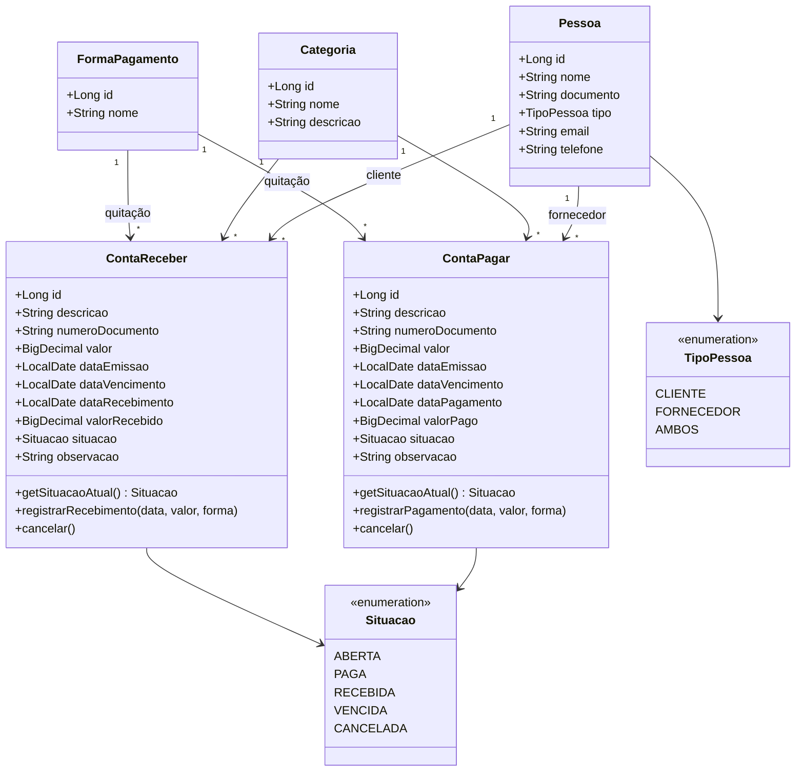
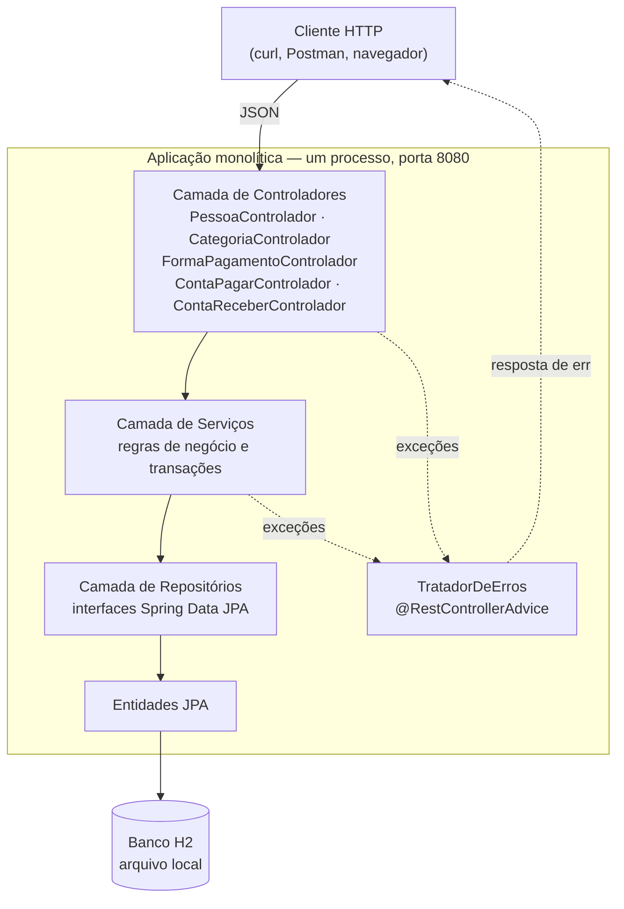
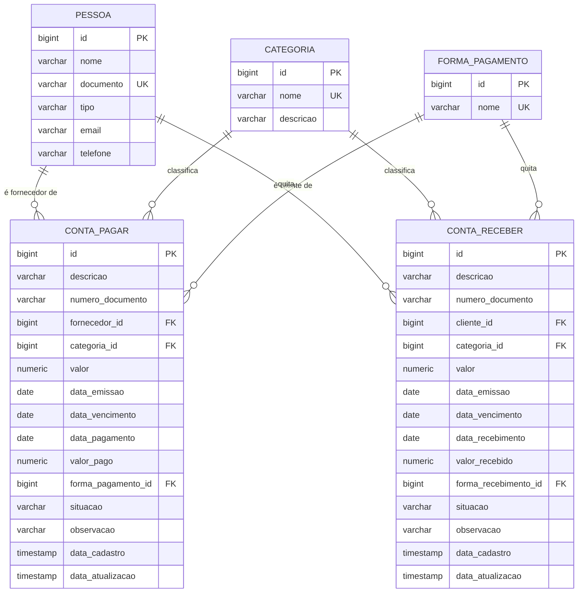
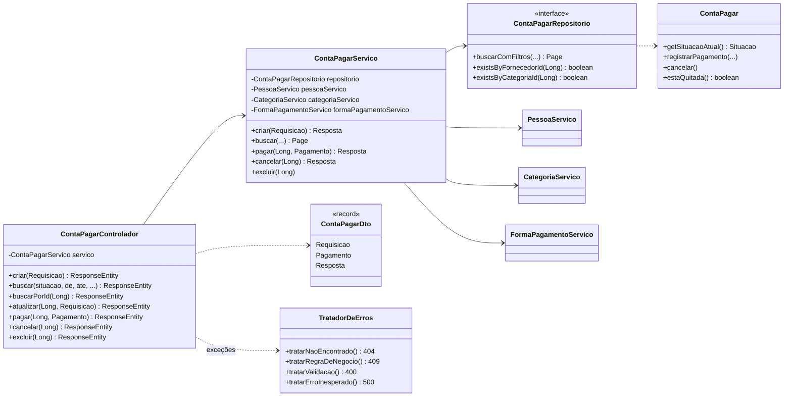
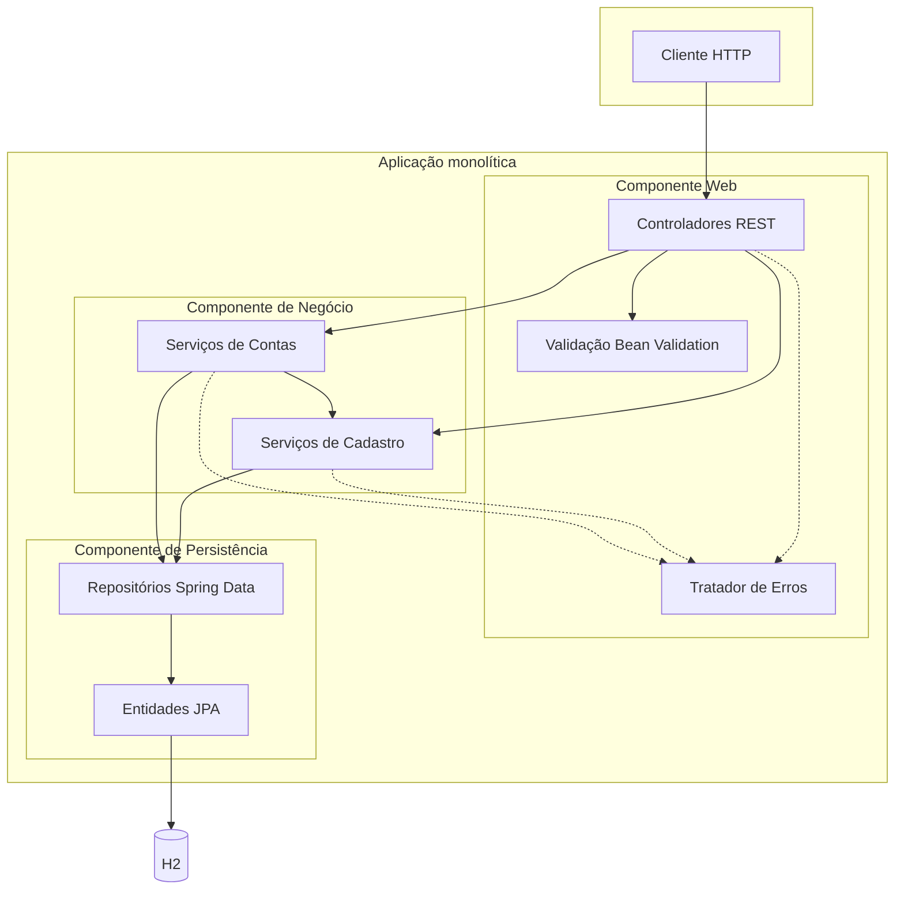
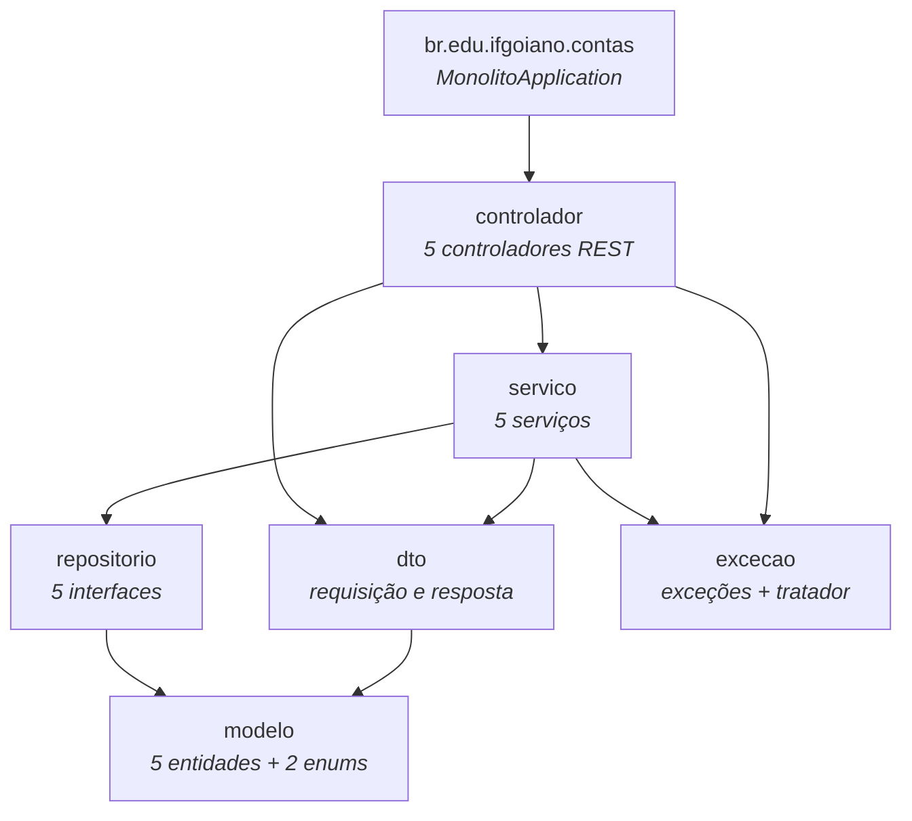
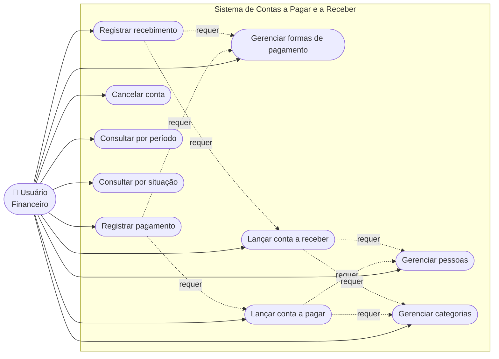
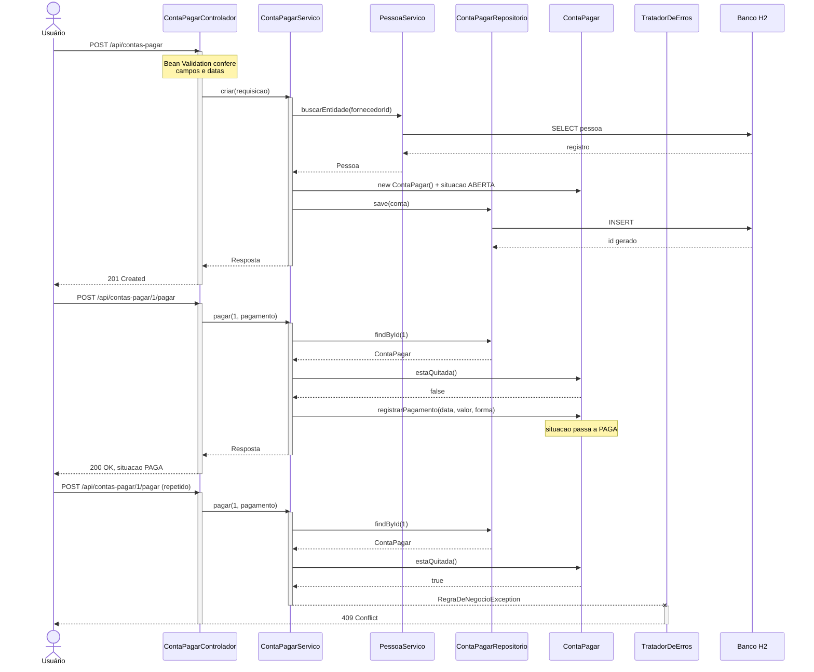

# Documentação do Projeto — Contas a Pagar e a Receber

**Disciplina:** Sistemas Distribuídos
**Etapa:** Aplicação monolítica
**Integrante:** Paulo Henrique Rodrigues de Lima

> As seções **9, 10, 13, 18 e 19** pertencem à etapa de microsserviços e serão escritas na entrega de 06/12/2026, conforme o próprio enunciado indica. Elas aparecem aqui apenas como marcação.

---

## 1. Descrição do Problema

Organizações precisam controlar o dinheiro que têm a pagar e o que têm a receber. Sem esse controle, três problemas aparecem: contas vencem sem que ninguém perceba, recebimentos atrasam sem cobrança, e não há como saber quanto a empresa deve ou tem a receber em um período.

O controle em planilhas é frágil. Não há validação, o histórico se perde, duas pessoas editando ao mesmo tempo sobrescrevem o trabalho uma da outra, e não existe registro de quando cada lançamento foi feito ou alterado.

O sistema resolve isso centralizando o controle financeiro em uma aplicação com regras de negócio aplicadas de forma consistente, histórico preservado e consultas por período e situação.

## 2. Objetivos da Aplicação

- Cadastrar pessoas (clientes e fornecedores), categorias financeiras e formas de pagamento
- Lançar contas a pagar e contas a receber com todas as informações necessárias ao acompanhamento
- Registrar a quitação de uma conta, preservando data, valor e forma utilizada
- Consultar contas por período de vencimento e por situação
- Impedir operações inválidas, como quitar duas vezes a mesma conta
- Expor tudo por uma API REST, preparando a decomposição em microsserviços da segunda etapa

## 3. Descrição das Regras de Negócio

### Cadastros

| # | Regra | Resposta quando violada |
| --- | --- | --- |
| RN01 | O documento da pessoa (CPF ou CNPJ) é único | 409 Conflict |
| RN02 | O nome da categoria é único, ignorando maiúsculas | 409 Conflict |
| RN03 | O nome da forma de pagamento é único | 409 Conflict |
| RN04 | Pessoa com contas vinculadas não pode ser excluída | 409 Conflict |
| RN05 | Categoria com contas vinculadas não pode ser excluída | 409 Conflict |
| RN06 | Forma de pagamento já usada em quitação não pode ser excluída | 409 Conflict |

### Contas

| # | Regra | Resposta quando violada |
| --- | --- | --- |
| RN07 | O valor da conta deve ser maior que zero | 400 Bad Request |
| RN08 | A data de vencimento não pode ser anterior à de emissão | 400 Bad Request |
| RN09 | A conta nasce sempre na situação ABERTA | — |
| RN10 | Conta já quitada não pode ser quitada novamente | 409 Conflict |
| RN11 | Conta cancelada não pode ser quitada | 409 Conflict |
| RN12 | A data da quitação não pode ser anterior à emissão da conta | 409 Conflict |
| RN13 | Conta quitada não pode ser alterada nem excluída | 409 Conflict |
| RN14 | Conta cancelada não pode ser alterada | 409 Conflict |
| RN15 | Conta já cancelada não pode ser cancelada de novo | 409 Conflict |
| RN16 | Fornecedor, cliente, categoria e forma informados devem existir | 404 Not Found |

### A regra da situação VENCIDA

Das cinco situações previstas no enunciado, quatro são gravadas no banco: `ABERTA`, `PAGA`, `RECEBIDA` e `CANCELADA`. A quinta, `VENCIDA`, **é calculada no momento da leitura**: uma conta `ABERTA` cujo vencimento já passou é apresentada como `VENCIDA`.

A alternativa seria gravar `VENCIDA` por meio de uma rotina agendada que varresse a base todo dia. Foi descartada porque, se a rotina falhasse ou a aplicação ficasse parada, o banco passaria a mentir sobre a situação das contas. Calculando na leitura, o dado está sempre correto, sem depender de processo externo.

Nas consultas, o filtro é traduzido antes de chegar ao banco:

| Filtro pedido | O que é consultado |
| --- | --- |
| `situacao=VENCIDA` | situação ABERTA com vencimento anterior a hoje |
| `situacao=ABERTA` | situação ABERTA com vencimento de hoje em diante |

Assim as duas são disjuntas: nenhuma conta aparece nas duas listas, e a soma delas é o total de contas em aberto.

## 4. Requisitos Funcionais

| # | Requisito |
| --- | --- |
| RF01 | Cadastrar, consultar, alterar e excluir pessoas |
| RF02 | Cadastrar, consultar, alterar e excluir categorias financeiras |
| RF03 | Cadastrar, consultar, alterar e excluir formas de pagamento |
| RF04 | Cadastrar, consultar, alterar e excluir contas a pagar |
| RF05 | Cadastrar, consultar, alterar e excluir contas a receber |
| RF06 | Registrar o pagamento de uma conta a pagar |
| RF07 | Registrar o recebimento de uma conta a receber |
| RF08 | Cancelar uma conta em aberto |
| RF09 | Consultar contas por período de vencimento |
| RF10 | Consultar contas por situação |
| RF11 | Filtrar contas por pessoa e por categoria |
| RF12 | Paginar e ordenar os resultados das consultas |

## 5. Requisitos Não-Funcionais

| # | Requisito | Como foi atendido |
| --- | --- | --- |
| RNF01 | Interface exclusivamente REST, em JSON | Spring Web com `@RestController` |
| RNF02 | Validação de todos os dados de entrada | Bean Validation nos DTOs |
| RNF03 | Respostas de erro padronizadas | `TratadorDeErros` com `@RestControllerAdvice` |
| RNF04 | Precisão exata em valores monetários | `BigDecimal` e `NUMERIC(15,2)` |
| RNF05 | Persistência que sobrevive ao reinício | H2 em arquivo |
| RNF06 | Separação em camadas | pacotes `controlador`, `servico`, `repositorio`, `modelo` |
| RNF07 | Executável sem instalação prévia | Maven Wrapper e banco embutido |
| RNF08 | Rastreabilidade das contas no tempo | `dataCadastro` e `dataAtualizacao` automáticas |
| RNF09 | Consultas paginadas | `Pageable` do Spring Data |

## 6. Principais Funcionalidades

**Cadastros de apoio.** Pessoas identificadas por documento único, classificadas como cliente, fornecedor ou ambos — porque a mesma empresa pode ser fornecedora em uma conta e cliente em outra. Categorias e formas de pagamento seguem o mesmo padrão CRUD.

**Lançamento de contas.** Cada conta guarda descrição, número do documento, pessoa, categoria, valor, data de emissão, data de vencimento, observação e situação. Contas a pagar e a receber são entidades independentes.

**Quitação.** Operação explícita e separada do cadastro: `POST /{id}/pagar` ou `POST /{id}/receber`, informando data, valor efetivamente pago e forma utilizada. O valor quitado é guardado à parte do valor original, o que permite registrar divergências.

**Cancelamento.** Conta em aberto que não será mais paga ou recebida é cancelada, não excluída — o registro permanece para consulta.

**Consultas.** Filtros opcionais e combináveis por situação, período de vencimento, pessoa e categoria, com paginação e ordenação.

## 7. Modelo de Domínio



### Decisão: duas entidades em vez de uma

`ContaPagar` e `ContaReceber` poderiam ser uma única entidade com um campo de tipo. Foram mantidas separadas porque a segunda etapa do projeto transforma cada uma em um microsserviço independente. Com tabelas separadas, esse corte não exige dividir dados nem reescrever consultas.

O custo é alguma duplicação de estrutura entre as duas, aceita conscientemente em troca da decomposição mais limpa.

## 8. Arquitetura Monolítica

Toda a aplicação é um único projeto, um único processo e um único banco. As funcionalidades são separadas por **camadas** e por **módulos de domínio**, não por processos.



**Fluxo de uma requisição:** o controlador recebe o JSON e valida o formato; o serviço aplica as regras de negócio dentro de uma transação; o repositório lê e grava; a resposta volta convertida em DTO. Qualquer exceção lançada no caminho é capturada pelo `TratadorDeErros`, que a transforma em resposta padronizada.

**Por que monolito nesta etapa:** uma chamada que envolve conta, pessoa e categoria acontece em memória, dentro de uma transação só. Não há rede entre as partes, não há falha parcial, e a consistência é garantida pelo banco. É o ponto de partida mais simples — e é justamente o que a segunda etapa vai colocar à prova.

## 9. Arquitetura de Microsserviços

> Entrega de 06/12/2026.

## 10. Justificativa da Divisão dos Serviços

> Entrega de 06/12/2026.

## 11. Descrição das APIs

Base: `http://localhost:8080`. Todo corpo é JSON (`Content-Type: application/json`).

### Pessoas — `/api/pessoas`

| Método | Rota | Descrição | Respostas |
| --- | --- | --- | --- |
| POST | `/api/pessoas` | Cadastra | 201, 400, 409 |
| GET | `/api/pessoas?nome=&page=&size=` | Lista paginada, filtro opcional por nome | 200 |
| GET | `/api/pessoas/{id}` | Busca por id | 200, 404 |
| PUT | `/api/pessoas/{id}` | Atualiza | 200, 400, 404, 409 |
| DELETE | `/api/pessoas/{id}` | Exclui | 204, 404, 409 |

```json
// POST /api/pessoas
{
  "nome": "Papelaria Central Ltda",
  "documento": "12.345.678/0001-90",
  "tipo": "FORNECEDOR",
  "email": "contato@papelaria.com.br",
  "telefone": "64 3333-1000"
}
```

`nome`, `documento` e `tipo` são obrigatórios. `tipo` aceita `CLIENTE`, `FORNECEDOR` ou `AMBOS`.

### Categorias — `/api/categorias`

Mesmas cinco operações. Corpo: `nome` (obrigatório, único) e `descricao`.

### Formas de pagamento — `/api/formas-pagamento`

Mesmas cinco operações. Corpo: `nome` (obrigatório, único).

### Contas a pagar — `/api/contas-pagar`

| Método | Rota | Descrição | Respostas |
| --- | --- | --- | --- |
| POST | `/api/contas-pagar` | Lança uma conta | 201, 400, 404 |
| GET | `/api/contas-pagar` | Consulta com filtros | 200, 400, 409 |
| GET | `/api/contas-pagar/{id}` | Busca por id | 200, 404 |
| PUT | `/api/contas-pagar/{id}` | Atualiza | 200, 400, 404, 409 |
| POST | `/api/contas-pagar/{id}/pagar` | **Registra o pagamento** | 200, 400, 404, 409 |
| POST | `/api/contas-pagar/{id}/cancelar` | Cancela | 200, 404, 409 |
| DELETE | `/api/contas-pagar/{id}` | Exclui | 204, 404, 409 |

```json
// POST /api/contas-pagar
{
  "descricao": "Compra de papel A4",
  "numeroDocumento": "NF-1001",
  "fornecedorId": 1,
  "categoriaId": 1,
  "valor": 450.00,
  "dataEmissao": "2026-10-01",
  "dataVencimento": "2026-11-10",
  "observacao": "Pedido mensal"
}
```

```json
// POST /api/contas-pagar/1/pagar
{
  "dataPagamento": "2026-10-20",
  "valorPago": 450.00,
  "formaPagamentoId": 1
}
```

**Parâmetros de consulta**, todos opcionais e combináveis:

| Parâmetro | Exemplo | Efeito |
| --- | --- | --- |
| `situacao` | `ABERTA`, `PAGA`, `VENCIDA`, `CANCELADA` | filtra pela situação |
| `de` | `2026-10-01` | vencimento a partir da data |
| `ate` | `2026-10-31` | vencimento até a data |
| `fornecedorId` | `3` | filtra pelo fornecedor |
| `categoriaId` | `2` | filtra pela categoria |
| `page`, `size`, `sort` | `0`, `20`, `valor,desc` | paginação e ordenação |

### Contas a receber — `/api/contas-receber`

Idêntica à anterior, com `clienteId` no lugar de `fornecedorId` e `POST /{id}/receber` no lugar de `/pagar`:

```json
// POST /api/contas-receber/1/receber
{
  "dataRecebimento": "2026-10-20",
  "valorRecebido": 1250.00,
  "formaRecebimentoId": 1
}
```

A situação `PAGA` não se aplica a contas a receber, nem `RECEBIDA` a contas a pagar: filtrar por elas devolve 409 com explicação.

### Formato das respostas de erro

Toda falha devolve o mesmo formato:

```json
{
  "momento": "2026-10-06T22:12:33.77",
  "status": 400,
  "erro": "Bad Request",
  "mensagem": "Dados invalidos. Verifique os campos informados.",
  "caminho": "/api/pessoas",
  "campos": [
    { "campo": "nome", "mensagem": "O nome e obrigatorio" },
    { "campo": "email", "mensagem": "E-mail invalido" }
  ]
}
```

`campos` aparece apenas em erros de validação.

## 12. Estratégia de Persistência

**Banco H2 em arquivo**, gravado em `monolito/dados/contas.mv.db`. A escolha equilibra duas necessidades: não exigir instalação de SGBD para executar o projeto, e manter os dados entre reinicializações — o que um banco em memória não faria.

**Mapeamento objeto-relacional** com Spring Data JPA sobre Hibernate. As tabelas são geradas a partir das entidades (`ddl-auto=update`). O arquivo `scripts/schema.sql` documenta a mesma estrutura em SQL, para quem precisar criar o banco em outro SGBD.

**Decisões relevantes:**

- **`BigDecimal` para valores**, mapeado como `NUMERIC(15,2)`. Ponto flutuante acumula erro de arredondamento, inaceitável em soma de valores financeiros.
- **Relacionamentos `LAZY`** por padrão, com `@EntityGraph` nas consultas de listagem. Sem isso, cada linha de uma página dispararia consultas adicionais ao montar a resposta — o problema conhecido como N+1.
- **`open-in-view=false`**. Com o padrão ligado, a sessão do banco fica aberta durante a renderização da resposta, mascarando acessos tardios e segurando conexões. Desligado, qualquer acesso fora da transação falha no desenvolvimento, em vez de virar lentidão em produção.
- **Conversão para DTO dentro da transação**, no serviço. Entidades JPA nunca são serializadas diretamente.

**Diagrama de Entidade e Relacionamento:**



## 13. Forma de Comunicação entre os Serviços

> Entrega de 06/12/2026.

## 14. Tratamento de Falhas

Todo erro passa por uma classe única, `TratadorDeErros`, anotada com `@RestControllerAdvice`. Sem ela, cada método precisaria do próprio `try/catch` e as respostas sairiam em formatos diferentes.

| Situação | Exceção | Status | Significado |
| --- | --- | --- | --- |
| Id inexistente | `RecursoNaoEncontradoException` | **404** | o recurso não existe |
| Operação proibida pelo estado atual | `RegraDeNegocioException` | **409** | o dado está certo, mas conflita com a situação |
| Campo inválido ou faltando | `MethodArgumentNotValidException` | **400** | corrija e tente de novo |
| JSON malformado ou enum inexistente | `HttpMessageNotReadableException` | **400** | corpo ilegível |
| Parâmetro de URL com tipo errado | `MethodArgumentTypeMismatchException` | **400** | ex.: `?de=ontem` |
| Restrição do banco violada | `DataIntegrityViolationException` | **409** | duplicidade ou vínculo |
| Qualquer falha não prevista | `Exception` | **500** | erro interno |

### Por que separar 400 de 409

É a distinção mais importante do tratamento de erros deste projeto. **400** significa que a requisição está malformada e o cliente deve corrigir o dado antes de repetir. **409** significa que a requisição está correta, mas conflita com o estado atual do recurso — repetir o mesmo envio não vai adiantar.

Tentar pagar uma conta já paga é o exemplo claro: o JSON está perfeito, os valores são válidos. O que impede é a conta já estar quitada. Responder 400 nesse caso levaria o cliente a procurar um erro de digitação que não existe.

### Validação devolve todos os erros de uma vez

A resposta 400 lista **todos** os campos reprovados, não apenas o primeiro. Evita o vai e vem de corrigir um erro por requisição.

### Erros inesperados não vazam detalhes

Uma exceção não prevista responde com mensagem genérica, enquanto a exceção completa vai para o log do servidor. Expor stack trace em resposta de API entrega detalhes internos a quem não deveria vê-los.

### Rede de segurança no banco

As regras de unicidade são verificadas no serviço antes da gravação, mas as restrições também existem no banco. Em acesso concorrente, duas requisições podem passar pela validação no mesmo instante e só o banco barrar a segunda — que é capturada e convertida em 409.

## 15. Procedimentos para Executar a Aplicação

**Pré-requisito:** JDK 21 ou superior. Nada mais precisa ser instalado.

```sh
cd monolito
./mvnw spring-boot:run      # no Windows: mvnw spring-boot:run
```

A aplicação sobe em `http://localhost:8080` e cria o banco na primeira execução.

**Console do banco:** `http://localhost:8080/h2-console`, com JDBC URL `jdbc:h2:file:./dados/contas`, usuário `sa` e senha em branco.

**Testes:** `./mvnw test`

**Dados de exemplo:** aplique `scripts/carga-exemplo.sql` pelo console do banco.

**Recomeçar do zero:** pare a aplicação e apague a pasta `monolito/dados`.

O passo a passo completo, com exemplos de chamada, está no [README](../README.md).

## 16. Testes Realizados

São **32 testes automatizados**, executados com `./mvnw test`. A saída completa está em [`evidencias/05-saida-dos-testes.txt`](evidencias/05-saida-dos-testes.txt).

| Classe | Testes | Tipo |
| --- | --- | --- |
| `SituacaoDerivadaTest` | 5 | unidade, regra de negócio |
| `ContaPagarControladorTest` | 14 | integração: endpoint, banco e regras |
| `ContaReceberControladorTest` | 6 | integração |
| `PessoaControladorTest` | 6 | integração |
| `MonolitoApplicationTests` | 1 | carga do contexto |

### Cenários cobertos

| Cenário | Dados | Resultado esperado | Obtido |
| --- | --- | --- | --- |
| Criar conta válida | fornecedor e categoria existentes, valor 500 | 201, situação ABERTA | ✔ |
| Valor zero e descrição vazia | valor 0, descrição "" | 400 com lista de campos | ✔ |
| Vencimento anterior à emissão | emissão 10/10, vencimento 01/10 | 400 | ✔ |
| Fornecedor inexistente | `fornecedorId` 99999 | 404 | ✔ |
| Buscar id inexistente | id 99999 | 404 | ✔ |
| Registrar pagamento | conta aberta, forma válida | 200, situação PAGA | ✔ |
| **Pagar a mesma conta duas vezes** | mesma requisição repetida | 409 | ✔ |
| **Receber a mesma conta duas vezes** | mesma requisição repetida | 409 | ✔ |
| Alterar conta já paga | PUT após quitação | 409 | ✔ |
| Excluir conta já paga | DELETE após quitação | 409, conta permanece | ✔ |
| Excluir conta aberta | DELETE em conta ABERTA | 204, depois 404 | ✔ |
| Cancelar conta duas vezes | POST /cancelar repetido | 200, depois 409 | ✔ |
| Pagamento anterior à emissão | pagamento em data retroativa | 409 | ✔ |
| Recebimento anterior à emissão | idem em conta a receber | 409 | ✔ |
| Consulta por situação PAGA | duas contas, uma quitada | só a quitada | ✔ |
| Consulta por situação RECEBIDA | duas contas, uma recebida | só a recebida | ✔ |
| Consulta por período | intervalo com e sem contas | 1 e 0 resultados | ✔ |
| Data inválida na URL | `?de=ontem` | 400 | ✔ |
| Situação PAGA em conta a receber | filtro incompatível | 409 explicativo | ✔ |
| Documento de pessoa duplicado | mesmo CNPJ duas vezes | 409 | ✔ |
| Nome vazio e e-mail inválido | ambos na mesma requisição | 400 com 2 campos | ✔ |
| Tipo de pessoa inexistente | `"tipo":"SOCIO"` | 400 | ✔ |
| Excluir pessoa com conta vinculada | pessoa com conta lançada | 409, pessoa permanece | ✔ |
| Ciclo completo de pessoa | criar, buscar, alterar, excluir | 201, 200, 200, 204 | ✔ |
| Situação VENCIDA derivada | conta aberta vencida ontem | VENCIDA na leitura, ABERTA no banco | ✔ |
| Conta que vence hoje | vencimento = hoje | continua ABERTA | ✔ |
| Conta paga vencida | paga, vencimento antigo | permanece PAGA | ✔ |

### Testes manuais com a aplicação em execução

Além dos automatizados, a aplicação foi exercitada pela API com 23 cenários, cujas saídas estão em [`evidencias/`](evidencias/):

- `01-fluxo-contas-pagar.txt` — cadastros e criação de contas
- `02-quitacao-e-consultas.txt` — pagamento, operações duplicadas e consultas por período e situação
- `03-contas-receber-e-cancelamento.txt` — recebimento, cancelamento e regras de integridade
- `04-persistencia-apos-reinicio.txt` — **prova de que os dados sobrevivem ao reinício**

## 17. Dificuldades Encontradas

### Spring Boot 4 não existe no repositório público

O Spring Initializr ofereceu a versão **4.1.1** como padrão, e o projeto gerado não compilou: o artefato não está publicado no Maven Central, onde a versão mais recente é a **3.5.3**. O `pom.xml` gerado também trazia dependências com nomes do Boot 4 (`spring-boot-starter-webmvc`, `spring-boot-h2console`), inexistentes no 3.x.

Foi preciso reescrever o `pom.xml` inteiro apontando para o 3.5.3 e corrigir os nomes das dependências. **Lição:** o que a ferramenta oferece como padrão nem sempre está disponível de fato; vale conferir no repositório antes de assumir.

### A situação VENCIDA não cabia no modelo

O enunciado lista `VENCIDA` junto com as outras quatro situações, o que sugere gravá-la no banco. Mas, diferente das demais, ela não resulta de uma ação do usuário: ela acontece sozinha, com a passagem do tempo.

Gravá-la exigiria uma rotina diária varrendo a base — e qualquer falha dessa rotina deixaria o banco mentindo. A saída foi calculá-la na leitura e traduzir o filtro nas consultas. Foi a decisão de modelagem que mais exigiu discussão.

### Testes compartilhando o mesmo banco em memória

As classes de teste rodam na mesma JVM e compartilham o banco. A limpeza de uma classe apagava pessoas que ainda tinham contas de outra apontando para elas, estourando violação de chave estrangeira. Resolvido limpando as duas tabelas de conta antes das pessoas, em todas as classes.

No mesmo lote, outro erro mais sutil: a extração do id da resposta usava uma expressão regular gulosa, que capturava o `id` do objeto aninhado em vez do id da conta. Os testes falhavam com 404 em contas que existiam. Trocado por leitura via JsonPath.

### _(a completar)_

> Espaço para as demais dificuldades enfrentadas durante o desenvolvimento: aprendizado do Spring Boot, organização do tempo, uso do Git, decisões que precisaram ser revistas.

## 18. Comparação entre as Arquiteturas

> Entrega de 06/12/2026.

## 19. Conclusão da Equipe

> Entrega de 06/12/2026.

---

# Diagramas

## Diagrama de Classes



O mesmo desenho se repete para contas a receber e para os três cadastros.

## Diagrama de Componentes



## Diagrama de Pacotes



As dependências apontam sempre em um sentido: controlador conhece serviço, serviço conhece repositório, repositório conhece entidade. Nenhuma camada de baixo conhece a de cima — é isso que permite trocar a camada web sem tocar nas regras de negócio.

## Diagrama de Casos de Uso

> O Mermaid não possui diagrama de casos de uso nativo. A representação abaixo usa um fluxograma com a mesma semântica: ator à esquerda, casos de uso à direita.



## Diagrama de Sequência

Lançamento e quitação de uma conta a pagar, incluindo a tentativa de pagar duas vezes:


